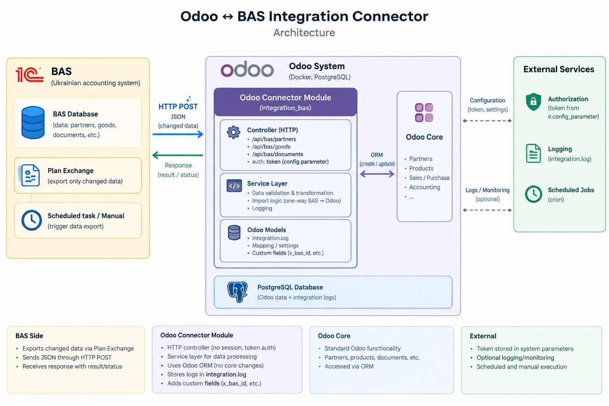

# BAS to Odoo Integration

An integration solution for synchronizing **BAS for small company. PROF (1.6.20.4) to Odoo 19.**

The project demonstrates how to connect an existing BAS system with Odoo using a custom HTTP API, JSON data exchange, an exchange plan, and batch processing.

## Overview

The integration transfers business data from BAS to Odoo while preserving external identifiers and recording synchronization results.

The data flow is one-way: **BAS → Odoo**.

## Key Features

- **BAS Exchange Plan** — tracks data changes that need to be synchronized.
- **Batch Processing** — transfers data in batches instead of sending all records in a single request.
- **JSON API** — exchanges structured data between BAS and Odoo.
- **Bearer Token Authentication** — protects the Odoo API endpoint.
- **External ID Mapping** — uses BAS identifiers to match imported records and avoid creating duplicates during subsequent imports.
- **Integration Logging** — records synchronization results in both BAS and Odoo.
- **Modular Architecture** — separates API handling, business logic, and logging.

## Architecture

The integration consists of two main components:

- **BAS extension** — prepares data for export, uses the exchange plan to identify changes, and sends JSON batches to Odoo.
- **Odoo module** — authenticates incoming requests, processes the received data, updates or creates records, and logs the results.



## Data Synchronization

The synchronization process follows these steps:

1. The BAS exchange plan identifies data that needs to be transferred.
2. BAS prepares a batch of records for export.
3. The data is serialized into JSON.
4. BAS sends an HTTP POST request to the Odoo API.
5. Odoo validates the Bearer token and processes the request.
6. The service layer creates or updates the corresponding Odoo records using their BAS external identifiers.
7. The integration result is recorded in the Odoo integration log and the BAS integration log.

The exchange plan supports incremental synchronization, reducing the need to repeatedly transfer the entire dataset.

The data exchange in BAS is started from the "Конектор odoo" processing form, accessible via All Functions.

## Supported Data

The integration covers the following business objects:

- Business partners
- Products and services
- Sales orders

## Technology Stack

### BAS

- Ukrainian BAS configuration
- 1C:Enterprise scripting language
- Exchange plans
- JSON serialization
- HTTP requests

### Odoo

- Odoo 19
- Python
- Odoo ORM
- Custom HTTP controllers
- PostgreSQL
- Bearer token authentication

## Integration Logs

Both systems maintain integration logs to help diagnose synchronization issues and review processing results.

### Odoo Integration Log


### BAS Integration Log


## Project Structure

```text
integration_bas/
├── controllers/
├── models/
├── services/
├── security/
├── views/
├── bas/
├── docs/
│   └── images/
│       ├── architecture.png
│       ├── integration_log_odoo.png
│       └── integration_log_bas.png
├── tests/
├── __init__.py
├── __manifest__.py
└── README.md
```

The `bas/` directory contains the BAS extension source files, while the Odoo module contains the API, business logic, models, and user interface components.

## Security

The Odoo API endpoint uses Bearer token authentication. The integration token should be configured securely and must not be committed to version control.

The API is intended for controlled system-to-system communication.

## Project Status

This project demonstrates a BAS-to-Odoo integration using change tracking, batch data transfer, API authentication, data processing, and integration logging.

## Disclaimer

This is an independent integration project developed for learning, demonstration, and portfolio purposes. It is not an official product of Odoo or BAS.